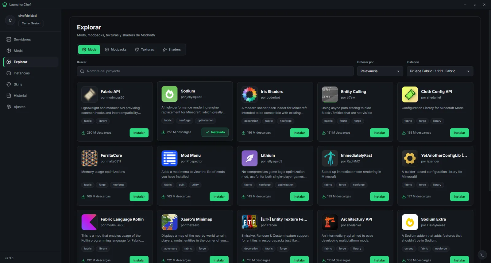
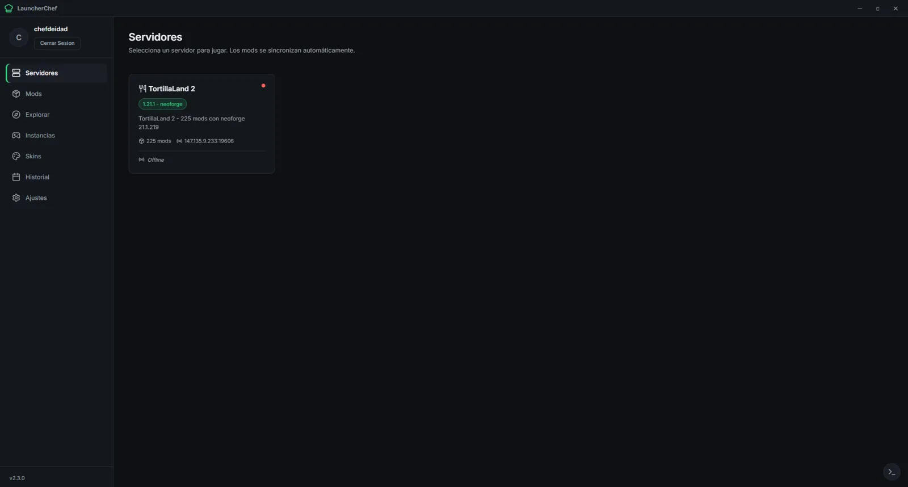
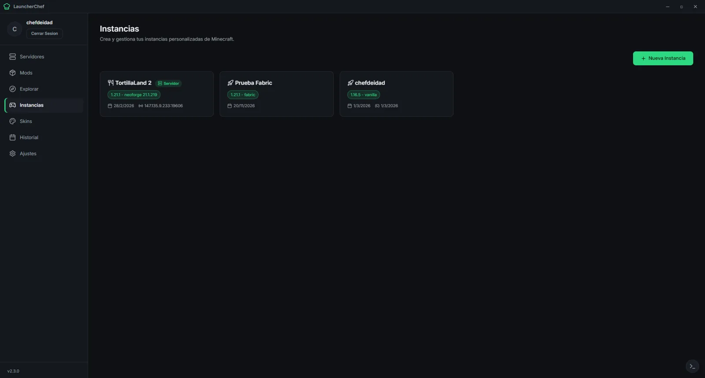
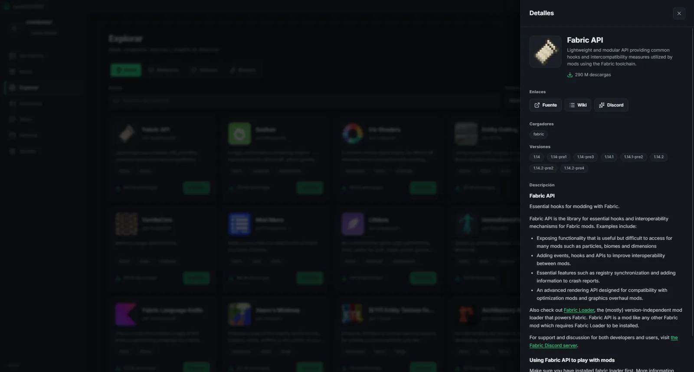
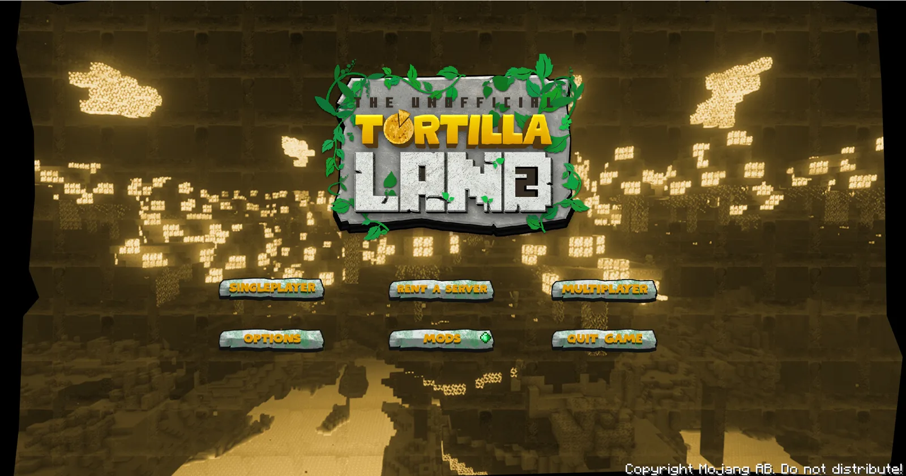

<div align="center">

# LauncherChef

**A Minecraft launcher for any version and mod loader, with Modrinth built in and one-click server modpack sync.**

[Download](https://github.com/CarlosFloresDev/launcherchefUPD/releases/latest) · [Report a bug](https://github.com/CarlosFloresDev/launcherchef/issues)


</div>



## Features

- **Any version, any loader** - create instances for vanilla, Fabric, Quilt, Forge (legacy and modern) and NeoForge. Tested from 1.12.2 to 1.21.x.
- **Automatic Java** - every Minecraft version gets the Java it needs (8, 17 or 21). Missing runtimes are downloaded from Eclipse Temurin and verified.
- **Modrinth built in** - browse mods, modpacks, resource packs and shaders, filtered by the selected instance's version and loader. Required dependencies are installed automatically.
- **Modpacks** - create a ready-to-play instance from any Modrinth modpack (`.mrpack`), with hash-checked downloads and overrides.
- **Server modpack sync** - point the launcher at a `distribution.json` and players get exactly the server's mods and configs, downloaded in parallel with retries and SHA-256 verification. Players' own extra mods are preserved.
- **Accounts** - Microsoft (premium) with automatic session refresh, or offline mode.
- **Shared game files** - libraries and assets are stored once and shared by every instance.
- **Admin mode** - optional tools to publish mods to a GitHub release and update `distribution.json`, hidden from regular players.
- **Extras** - server status and latency, play history, skin management, live log console and auto-updates.

| Servers | Instances |
|---|---|
|  |  |

| Project details | In game |
|---|---|
|  |  |

## How it works

```
Renderer (HTML/CSS/JS, sandboxed)  ──IPC──>  Main process (Node.js)
  Servers · Instances · Explore                ├─ launchHandler     minecraft-launcher-core + loader setup
                                                ├─ javaManager       Java per version, Temurin downloads
                                                ├─ loaderProfiles    Fabric / Quilt profiles
                                                ├─ modrinthHandler   search, install, .mrpack import
                                                ├─ modSyncHandler    server modpack sync
                                                ├─ authHandler       Microsoft / offline accounts
                                                └─ githubHandler     admin: publish mods to releases
```

- **Security**: context isolation and renderer sandbox, no navigation or new windows, external links restricted to `http(s)`. Account and GitHub tokens are encrypted with the OS keychain (DPAPI on Windows) through Electron `safeStorage`.
- **Downloads**: atomic writes through `.part` files, retries with backoff, and SHA-1/SHA-256/SHA-512 checks whenever the source provides a hash. Modpack paths are validated so a pack cannot write outside its instance.
- **Data location**: `%APPDATA%/LauncherChef` (configurable game directory). In development, state lives in `.dev/`, which is git-ignored.

## Development

```bash
npm install
npm start          # run the launcher
npm run dev        # run with DevTools
npm run build:win  # build the Windows installer into dist/
```

Icons come from [Lucide](https://lucide.dev) and are bundled as an SVG sprite. After using a new icon name, run `node tools/build-icons.js`.

## Server modpacks

1. Put the server's mods in a folder and generate the manifest: `npm run generate-manifest`.
2. Host the mods (for example as GitHub release assets) and the resulting `distribution.json`.
3. Set the manifest URL in **Settings > Distribution server**. Players will sync automatically before launching.

See [`distribution-example.json`](distribution-example.json) for the format.

## License

MIT © Carlos Llano. Minecraft is a trademark of Mojang AB; this project is not affiliated with Mojang or Microsoft.
